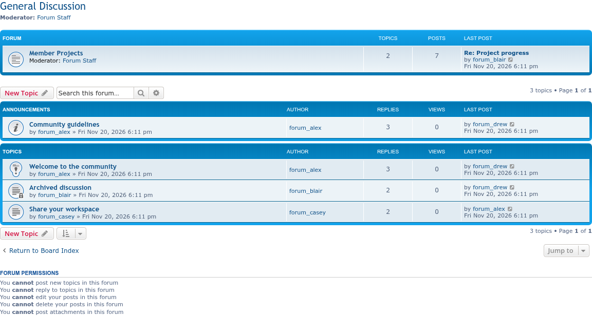
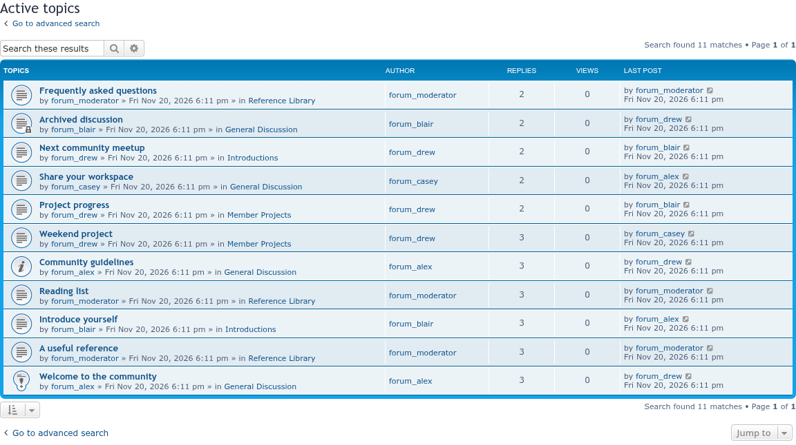
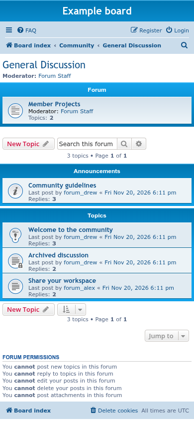

# Author Column screenshots

Taken on phpBB 3.3 with prosilver, using `phpbb-test-board/screenshots.py` from [phpbb-release-tools](https://github.com/phpbbmodders/phpbb-release-tools), on a board filled with seed-forum's standard fixtures, as a guest. Click an image for the full size.

## Forum topic list

The **Author** column sits between the topic title and **Replies**, for announcements and normal topics, with each username in its group colour.

## Topic search results

Topic search results get the column too. This is **Active topics**; **Unanswered topics** and searches by author look the same. Post-mode search results are unchanged.

## Phones and narrow screens

On screens 950px wide or narrower the column is hidden, so the topic titles keep their room. Down to prosilver's phone layout, the "by" line under each title still names the author; on a phone, prosilver's own phone layout is used, unchanged.

